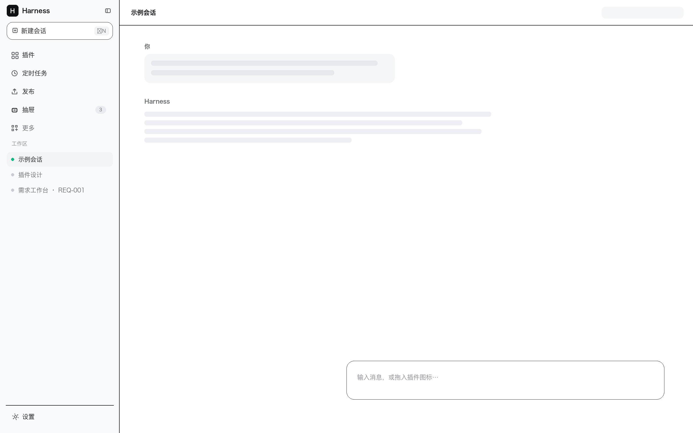
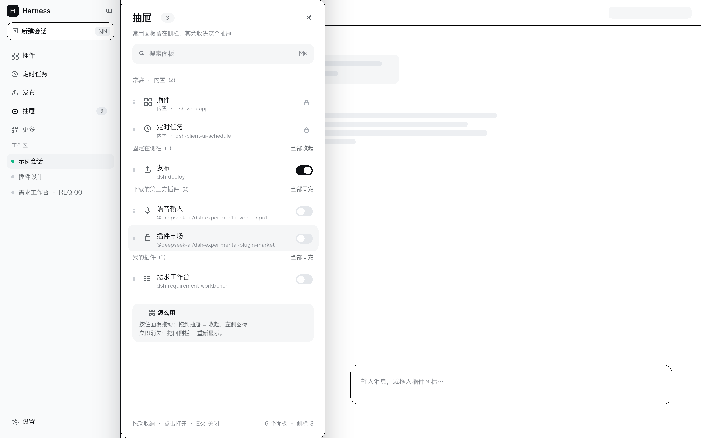
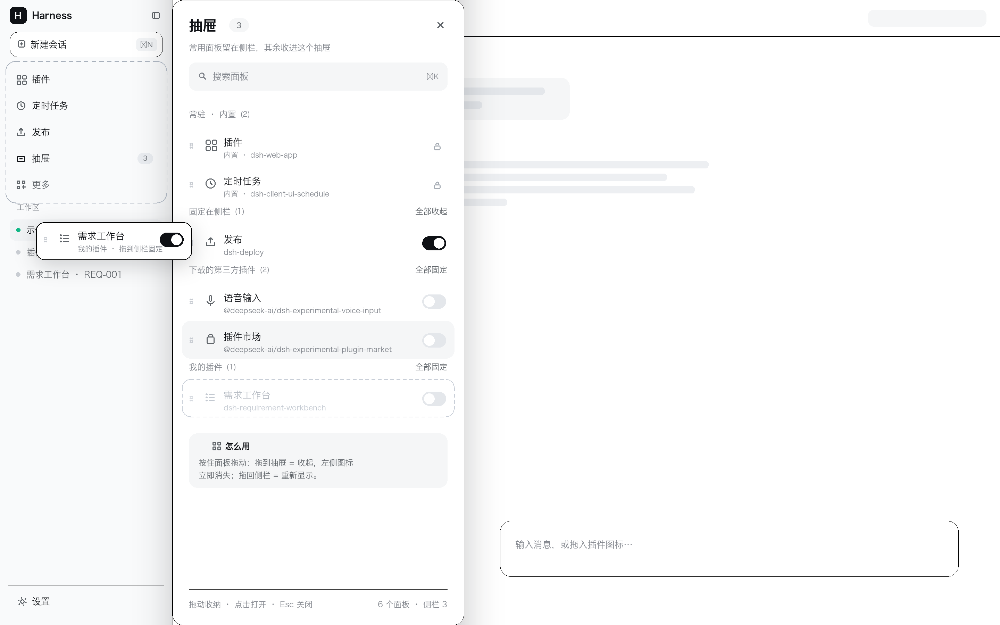

# dsh-drawer

给 [DeepSeek Harness](https://github.com/deepseek-ai/deepseek-harness)（DSH）Web UI 用的「抽屉」插件：把不常用的全局面板收进侧栏右侧的抽屉里，常用的留在左侧；支持按住面板在侧栏 / 抽屉之间一个个拖拽，也可以上下拖动调整显示顺序。

> A side drawer for the DSH sidebar: tuck rarely used panels away, keep the usual ones on the left, drag them in and out one by one, and drag up/down to reorder.

---

## 特性

- **抽屉入口**：注册在侧栏 `sidebar.panellist`，排在官方「更多」上面；角标显示已收起数量。
- **宽抽屉**：贴在左侧栏右边滑出，默认 **420px**（可配 360–520），不遮挡侧栏——拖进拖出时左侧图标变化实时可见。
- **拖拽收纳**：按住侧栏图标拖到抽屉 = 收起（左侧图标立即消失）；从抽屉拖回左侧 = 重新显示。
- **拖拽排序**：按住面板上下拖，蓝色插入线指示落点；侧栏图标顺序同步变化，「恢复默认顺序」可一键还原。
- **按来源分组**：常驻 · 内置 / 固定在侧栏 / 下载的第三方插件 / 我的插件。来源由 host 半只读 profile 判定（`package.json` 依赖、`node_modules` 软链、`cordis.patch.yml` 行），可在配置里手动覆盖。
- **已安装插件列表**：抽屉底部可展开「已安装插件 · 无侧栏入口」，列出所有已安装但没注册侧栏图标的插件，可跳转「插件」页。
- **持久化**：收起状态与自定义顺序存 `localStorage`，重启保留；卸载插件时恢复全部显示并清理注入的样式。
- **键盘 / 可访问性**：`Esc` 关闭、`⌘/Ctrl + K` 打开、开关为 `role="switch"`，颜色全部走 DSH 主题令牌（自动适配浅色 / 深色）。

## 截图

> 设计稿示意（真实界面取决于你的侧栏宽度与主题）。

| 关闭态 | 打开态 | 拖拽 / 排序 |
|---|---|---|
|  |  |  |

## 安装

这是一个 **本地 bundle 插件**（不是 npm 包），需要接进某个 DSH profile。

### 方式一：交给 DSH Agent 安装（推荐）

克隆到本地后，在 DSH 会话里让 Agent 对本目录执行 `plugin_manager install_bundle`：

```text
把 /path/to/dsh-drawer 这个 bundle 装进当前 profile
```

### 方式二：手动接入 profile

```bash
git clone git@github.com:tanghaifeng/dsh-drawer.git
cd dsh-drawer
```

1. 建软链接（把 `<profile>` 换成你的 profile 名，默认 `desktop`）：

   ```bash
   ln -s "$(pwd)" ~/.dsh/profiles/<profile>/node_modules/dsh-drawer
   ```

2. 在 `~/.dsh/profiles/<profile>/package.json` 里登记 bundle 与依赖：

   ```jsonc
   {
     "dsh": {
       "profile": {
         "bundles": [
           // ...其它的，
           "dsh-drawer"
         ]
       }
     },
     "dependencies": {
       // ...其它的，
       "dsh-drawer": "link:/绝对路径/dsh-drawer"
     }
   }
   ```

3. 重启 DSH（或重新加载 profile），刷新页面。

> 插件本身没有再装任何 npm 依赖；`package.json` 里的 `react` 只是 peerDependency。

## 配置

插件行的 `config` 可以写在 bundle 自带的 `cordis.patch.yml`，也可以写在 profile 的 `cordis.patch.yml` 里覆盖：

```yaml
- id: drawer
  config:
    width: 420          # 抽屉宽度，360–520
    profileDir: null     # 覆盖 profile 目录（默认取 DSH_PROFILE_DIR）
    groups:              # 手动覆盖面板来源：builtin / own / third
      deploy: own
      some-third-party-panel: third
```

## 使用

| 操作 | 结果 |
|---|---|
| 点侧栏「抽屉」行（整行可点） | 打开 / 关闭右侧抽屉 |
| 按住箭头面板上下拖 | 调整显示顺序（蓝色插入线） |
| 按住侧栏图标左右拖进抽屉 | 收起，左侧图标消失 |
| 按住抽屉里的面板拖回左侧 | 放回，左侧图标出现 |
| 点行 / 开关 | 打开面板 / 固定或收起 |
| 分组右上角「全部收起 / 全部固定」 | 按分组批量操作 |
| `Esc` / `⌘K` | 关闭抽屉 / 打开抽屉 |

> 内置面板（`插件`、`自动化任务`）是常驻项：可以拖动排序，但不会被收进抽屉。

## 工作原理

- **入口行**：注册 `sidebar.panellist`（`id=drawer`，`order=900`），点击拦截为打开抽屉。
- **官方「更多」**：注册 `sidebar.panellist.actions`，让官方「更多」这一行保留为兜底入口。
- **抽屉浮层**：注册 `shell.overlay`，按自己的入口行反推侧栏右边缘，贴在它右侧渲染 420px 抽屉。
- **收起 / 显示**：复用 `ui-sidebar` 的原生 pin——从 `sidebar` 注册项的注入面取 `setPinned(id, pinned)`。原生 pin 是内存态，本插件用 `localStorage` 回放。
- **侧栏排序**：注入 `nav button[aria-label="…"]{order:…}` 样式规则（不改其它插件的注册）。DSH 若改侧栏结构，最差是排序不生效，不影响其它功能。
- **来源分组**：host 半只读 profile，通过同源接口 `POST /api/dsh-drawer/context` 提供给前端；前端再按面板 id 与包名对齐（`cordis.patch.yml` 行 id → 包名，或包名前缀归一化匹配）。

## 目录结构

```text
dsh-drawer/
├── lib/
│   ├── index.js          # host 半：读 profile、注册 /api/dsh-drawer/context
│   └── client.js         # client 半：入口行、宽抽屉、分组、拖拽/排序（单文件 bundle）
├── cordis.patch.yml      # bundle 行（含默认 width）
├── icon.svg              # 插件包图标
└── design/               # 设计稿（示意图）
    ├── drawer-closed.png
    ├── drawer-wide.png
    └── drawer-drag.png
```

## 开发

- 客户端是单文件 bundle（`window.__ModuleLoader__.load`），只 `require("react")`，不 import 任何 Harness Client 包。
- 改完 `lib/client.js` / `lib/index.js` 后，重载插件（或重启 DSH）即可；本仓库没有构建步骤。

## 兼容性与已知限制

- 在 **DSH `0.2.1-rc.5`** 上验证。
- 依赖 DSH 的内部槽位（`sidebar.panellist`、`sidebar.panellist.actions`、`shell.overlay`、`main`）与 `ui-sidebar` 的注入面（`setPinned`）。这些不是公开 API，DSH 升级后可能失效；失效时抽屉本身仍会打开，但「隐藏 / 排序」可能不生效。
- 抽屉只收录**注册了侧栏全局面板**的插件；其它插件只出现在「已安装插件」列表里（只能跳转插件页，不能固定）。
- 拖拽只改变显示顺序，不改变插件注册顺序。
- 侧栏排序靠 CSS `order` 注入实现，视觉顺序变化，DOM 顺序与键盘 Tab 顺序保持原样。

## License

[MIT](LICENSE)
